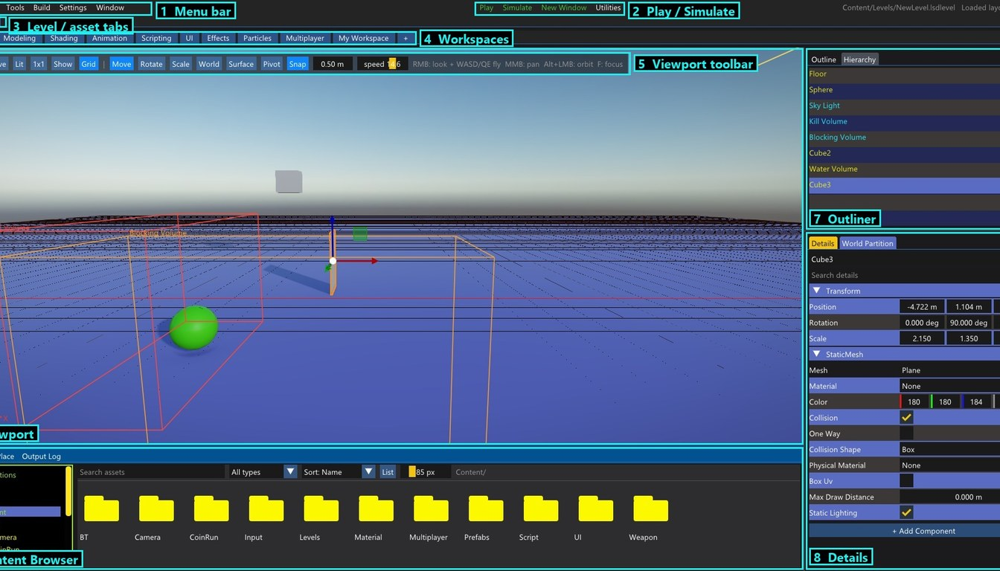
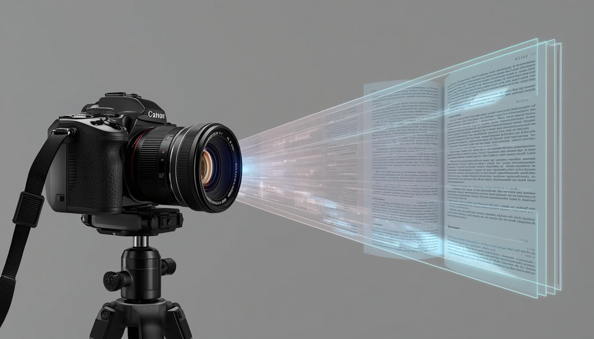
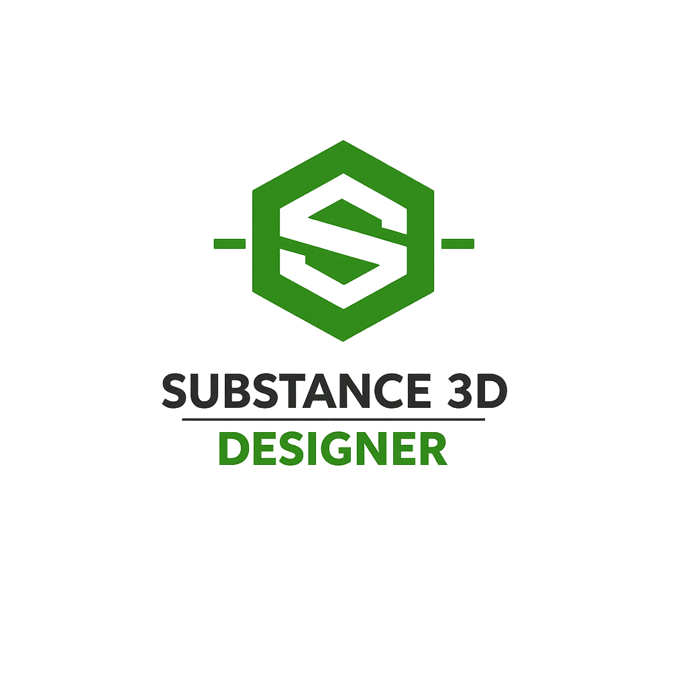
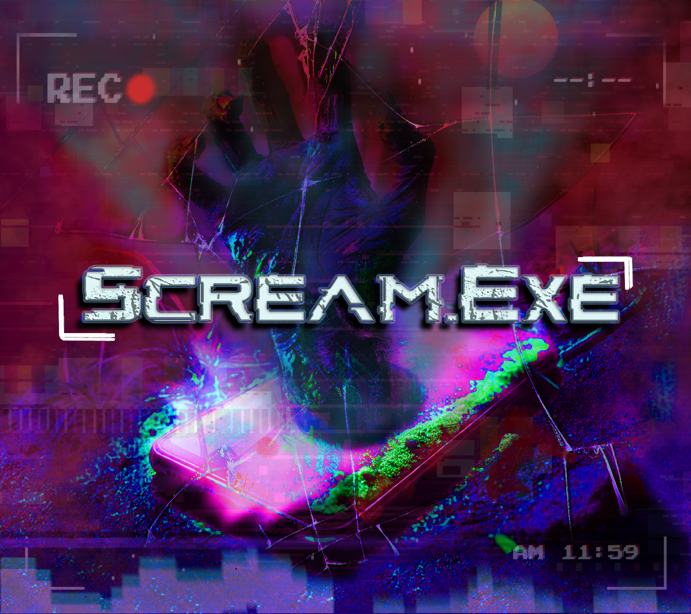

<h1>Hi, I’m Charlize! 
</h1>

<h2>About Me</h2>

My name is Charlize Pauli. I'm a Computer Science Student from the University of Veiga de Almeida (UVA),
I focus in Software Development, Web Development and Game Development.
Open for work : Freelance, Long-term or short-term Contracts.

  
[Open for Work]
 
[Open for Commissions]

-Programming
 
C, C++, C#, HTML, CSS, Javascript, Python, Lua, Three.Js
 
2 year of experience in IT.
<h></h>

-Game Dev
 
3D Generalist, Unreal Dev , Unity Dev
2 years of experience in the Games Industry.

https://www.artstation.com/charchar96

## Computer Science 

<table align="center"><tr>
    <td allign="center">
       
        C
    </td>
    <td allign="center">
       
        C++
    </td>
    <td allign="center">
       
        HTML
    </td>
    <td allign="center">
       
        CSS
    </td>
    <td allign="center">
       
        Javascript
    </td>
    <td allign="center">
       
        Python
    </td>
    <td allign="center">
       
        Lua
    </td>
</table></tr>

## Projects Developed
<table align="center">
  <tr>
    <td align="center">
      <a href="https://github.com/Eviee556/Leorix"> 
          Leorix [WIP]</a>
    </td>
    <td align="center">
      <a href="https://github.com/Eviee556/GeoStrands"> 
      GeoStrands 1.0</a>
    </td>
    <td align="center">
      <a href="https://github.com/Kittakin-Studios/LSD_Engine"> 
      LSD_Engine</a>
    </td>
    <td align="center">
       
      <!--[a link]( )-->
      ScreenShot 1.0
    </td>   
    <td align="center">
       
      <!--[a link]( )-->
      Study Companion 1.0.1
    </td>
</table></tr>

If you like my work please consider supporting me so I can continue to make amazing softwares 👾
[a link](https://ko-fi.com/eviee556)
  
## Indie Game Dev
2+ years Experience in Games Industry.

I have worked in the following games : 
 
"Libertas" Ad Astra
 
"Aetherlands" Splix Studio

<table align="center">
  <tr>
    <td align="center">
       
      Blender
    </td>
    <td align="center">
       
      Cascadeur
    </td>
    <td align="center">
       
      FiberShop
    </td>
    <td align="center">
       
      Affinity Designer
    </td>
  </tr>
  <tr>
    <td align="center">
       
      Clip Studio Paint
    </td>
    <td align="center">
       
      Visual Studio Code
    </td>
    <td align="center">
       
      Marmoset Toolbag 5
    </td>
    <td align="center">
       
      RizomUV
    </td>
  </tr>
  <tr>
    <td align="center">
       
      Substance Painter
    </td>
    <td align="center">
       
      Substance 3D Designer
    </td>
    <td align="center">
       
      Unreal Engine
    </td>
              </td>          
    <td align="center">
       
      Zbrush
    </td>
  <tr>
           </td>
    <td align="center">
       
      Marvelous Designer
    </td>
            </td>
    <td align="center">
       
      Character Creator 5
     </td>
     </td>
     <td align="center">
       
      Sisir
     </td>
             </td>
    <td align="center">
       
      Topogun 3
    </td>
    </tr>
    <tr>
            </td>
    <td align="center">
       
      3DSMax
    </td>
                  </td>
    <td align="center">
       
      Maya
    </td>
                      </td>
    <td align="center">
       
      Photoshop
    </td>

  </td>
    <td align="center">
       
      Metahuman
    </td>
</table></tr>

<!-- 
        </td>
    <td align="center">
       
      (Add Caption)
    </td>
    -->
<!--## 🎨 My Work 

 

  
  <!--
  
  
  
  
  
  
  
  
  
  
  
  
  -->

